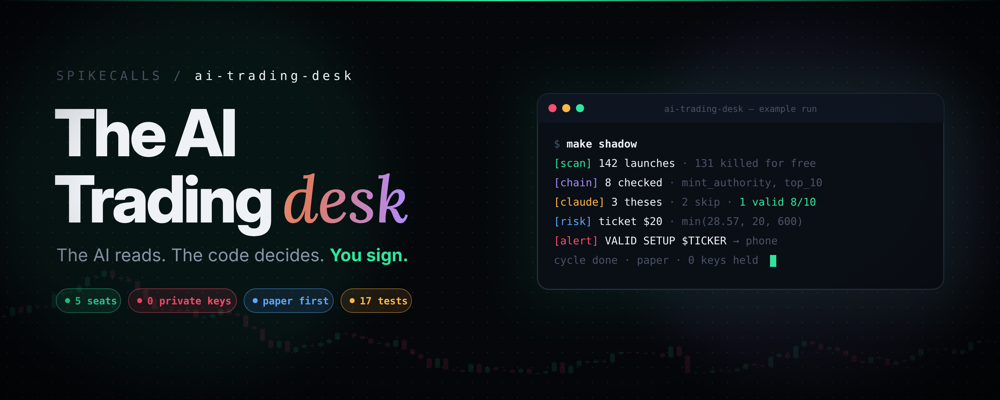
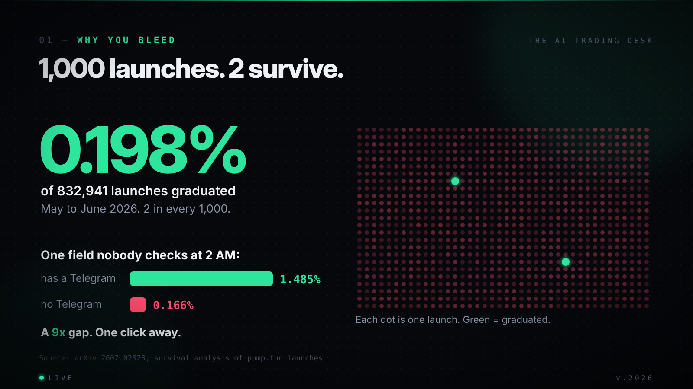
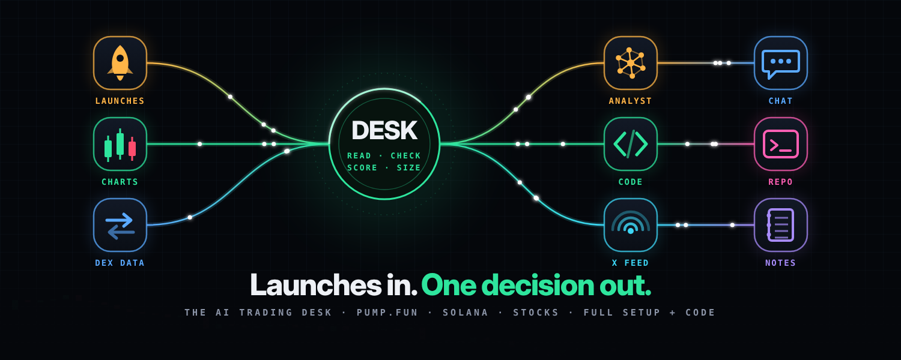
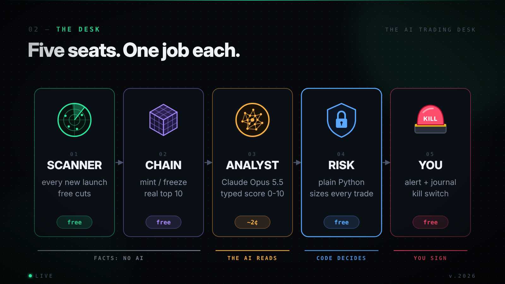
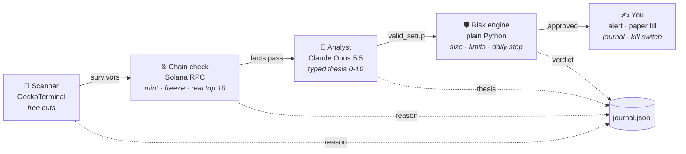
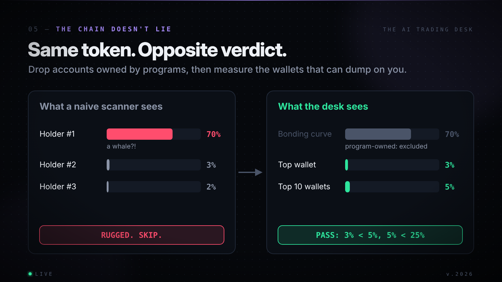
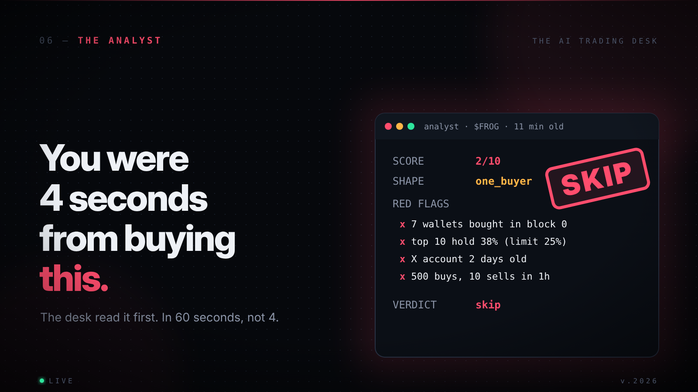
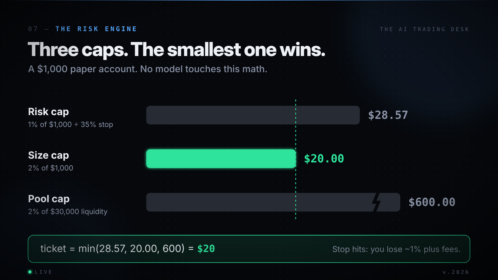
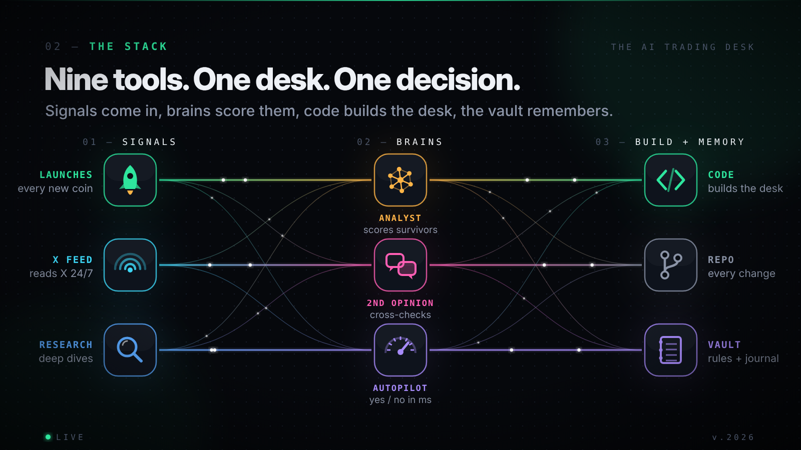

<div align="center">



# The AI Trading Desk

**Every launch scanned. Every dev wallet checked. Claude scores what's left, code sizes the trade, and you only see what survives.**

[](https://github.com/SpikeCalls/ai-trading-desk/actions/workflows/tests.yml)


[](LICENSE)

[Quick start](#-quick-start) · [How it works](#-how-it-works) · [The stack](#-the-full-stack) · [Config](#-config) · [FAQ](#-faq) · [Telegram](https://t.me/+Ykc8YKaJR6Q3NDNk)

</div>

---

> **The AI reads. The code decides. You sign.**
>
> A five-seat desk for pump.fun launches, any Solana token, and US stocks. It reads every launch, kills what plain facts can kill, lets Claude score the survivors with a typed thesis, sizes the trade with rules no model can touch, and pings you. It never holds a key and never signs a transaction.



## Why

In a study of **832,941** pump.fun launches (May to June 2026), **0.198%** graduated from the bonding curve. Launches that advertised a Telegram graduated at **1.485%**; launches without one at **0.166%**. ([arXiv 2607.02823](https://ideas.repec.org/p/arx/papers/2607.02823.html))



The information that kills a bad trade is public and one click away: the holder tab, the dev wallet, the mint authority, the socials. Humans skip it because it takes 60 seconds and the candle takes 4. A machine doesn't skip.

## ⚡ Quick start

```bash
git clone https://github.com/SpikeCalls/ai-trading-desk.git
cd ai-trading-desk
python3 -m venv .venv && source .venv/bin/activate
pip install -r requirements.txt
cp .env.example .env              # add ANTHROPIC_API_KEY (Telegram + RPC optional)

make test                         # 17 offline tests, no keys needed
make shadow                       # one full cycle: scan, check, score, alert. No position.
make paper                        # paper trading, every 60 seconds
```

Stocks on a free Alpaca paper account:

```bash
make stocks
```

Stop everything, from anywhere:

```bash
touch KILL                        # next cycle: close all, stop
```

## 🧠 How it works



Each seat costs more than the one before it, so each one has to kill harder.



| Seat | File | Job | Model? |
| --- | --- | --- | :---: |
| 🚀 **Scanner** | [`desk/scanner.py`](desk/scanner.py) | Fresh pump.fun / PumpSwap pools from GeckoTerminal. Kills on age, liquidity, volume, market cap, trade count and sell ratio. | ❌ |
| ⛓️ **Chain check** | [`desk/chain.py`](desk/chain.py) | Mint and freeze authority, top wallet and top 10 share of **real wallets**. The curve and pool are excluded by owner program. | ❌ |
| 🧠 **Analyst** | [`desk/analyst.py`](desk/analyst.py) | Claude Opus 5.5 fills a typed `TokenThesis`: verdict, score, red flags, shape, invalidation, sources. Never "buy". | ✅ |
| 🛡️ **Risk engine** | [`desk/risk.py`](desk/risk.py) | Verdict and score gates, quiet hours, daily loss stop, max positions. Ticket = `min(risk cap, size cap, 2% of pool)`. | ❌ |
| ✍️ **You** | [`desk/broker.py`](desk/broker.py) · [`desk/ops.py`](desk/ops.py) | Paper fills with fees and slippage, rule-based exits, journal, bench, Telegram alerts, kill switch. | ❌ |

### Same token, opposite verdict

On a pump.fun token the biggest holder is always the bonding curve. Count it as a whale and everything looks rugged. The desk asks the chain who owns each top account, drops program-owned ones, and measures only wallets that can dump on you.



### The analyst fills a form, not a vibe

```python
class TokenThesis(BaseModel):
    verdict: Literal["skip", "watch", "valid_setup"]   # never "buy"
    score: int                                         # 0-10, clamped in code
    red_flags: list[str]                               # most dangerous first
    green_flags: list[str]
    shape: Literal["crowd", "one_buyer", "fading", "too_early"]
    invalidation: str                                  # what would prove this wrong
    sources: list[str]                                 # input fields it rests on
```

Every string a stranger wrote (token names, links, headlines) reaches the model wrapped as untrusted data. Even a fooled analyst can't size a position or place an order: those jobs belong to code.



### Three caps, the smallest one wins



### Exits: code, not conversation

| Rule | Value |
| --- | --- |
| Stop | -35% from entry |
| Take profit | sell half at 2x, once |
| Volume decay | close when 6h volume < 20% of the 24h pace (after 30 min held) |
| Time out | 24 hours, or the moment the price can't be fetched |
| No revenge | a closed token sits out 6 hours |

## 🧩 The full stack



The repo ships the core desk. Around it, every tool has one job:

| Layer | Tool | Job |
| --- | --- | --- |
| **Signals** | pump.fun | The market: every launch, curve and graduation |
| | Grok Bot | Reads X 24/7: narratives, project accounts, who's talking |
| | Grok | Quick X lookups on one post or one account |
| | REA | Research seat: deep dives on a narrative |
| **Brains** | Claude Opus 5.5 | The analyst seat in this repo |
| | ChatGPT | Second opinion. If the two disagree, skip |
| | Jev | Typed yes/no gates with probabilities, in milliseconds |
| **Build + memory** | Claude Code | Builds and fixes the desk |
| | GitHub | Every rule change, versioned |
| | Obsidian | The vault: rules, journal, wallet blacklist, narratives |

Only Claude is wired into the code. The rest sit around it in the workflow: see [`docs/STACK.md`](docs/STACK.md) for the research loop and copy-paste prompts.

## ⚙️ Config

Every number lives in [`config.py`](config.py). Retune there and nowhere else. These are starting values, not advice.

| Group | Key | Default |
| --- | --- | --- |
| Scanner | age window | 10 min to 6 h |
| | min liquidity / 1h volume | $8,000 / $15,000 |
| | market cap window | $25k to $5M |
| | min trades 1h / sell ratio | 120 / 0.15 |
| Chain | max top wallet / top 10 | 5% / 25% |
| | mint or freeze authority | hard no |
| Analyst | model / min score | `claude-opus-5-5` / 7 |
| Risk | risk per trade / max position | 1% / 2% of equity |
| | max share of pool | 2% |
| | daily loss stop / max positions | -3% / 3 |
| | quiet hours | 01:00 to 07:00 local |

## 💸 What it costs

The analyst only sees tokens that survived every free check, capped at 3 calls per cycle. One call is roughly 1,500 tokens in and 600 out: about **$0.02** at Opus 5.5 list prices ($4 / $20 per million). A busy day of 300 calls is about $5. A dead market costs almost nothing. Check Anthropic's pricing page for current rates.

## 📊 Sunday review

```bash
make review          # stats from journal.jsonl
make review-claude   # plus a blunt written review from a cheaper model
```

Read the rejections, not just the trades. They tell you whether your filters cut losers or cut winners. Then change **one** number in `config.py` and run another week.

## 🗂️ Project structure

```
ai-trading-desk/
├── config.py           every threshold
├── run_crypto.py       the loop: scan → chain → analyst → risk → paper
├── run_stocks.py       Alpaca paper, OTO orders with the stop attached
├── review.py           weekly stats + optional Claude review
├── desk/
│   ├── scanner.py      seat 1: GeckoTerminal + DexScreener
│   ├── chain.py        seat 2: Solana RPC facts
│   ├── analyst.py      seat 3: Claude, typed theses, untrusted-input wrapping
│   ├── risk.py         seat 4: pure-code sizing and limits
│   ├── broker.py       seat 5: paper broker + rule-based exits
│   └── ops.py          journal, bench, Telegram, kill switch
├── prompts/            manual mode: the same desk as a Claude Project
├── docs/               architecture, the full stack, research prompts
├── tests/              offline tests, no keys needed
└── assets/             images used in this README
```

## 🔒 Rules this repo will not break

1. No private keys, no signing, no live crypto execution. Ever.
2. The model never sizes a position or places an order.
3. Every third-party string reaches the model wrapped as untrusted text.
4. A missing number is missing, never a pass.
5. Paper first. Weeks, not days. Never trust a backtest of model judgement: it may remember how the story ended.

## ❓ FAQ

<details>
<summary><b>Can it trade live on Solana?</b></summary>

No, by design. It alerts you with the mint, links and the thesis, and you decide in your own terminal. That signature is the last check.
</details>

<details>
<summary><b>Do I need to know Python?</b></summary>

No. [`prompts/manual-mode.md`](prompts/manual-mode.md) runs the same desk by hand as a Claude Project with a copy-paste prompt pack.
</details>

<details>
<summary><b>Why paper only for weeks?</b></summary>

A good week on paper is noise. A good quarter is a starting point. The journal is how you find out whether the filters work.
</details>

<details>
<summary><b>Will this make money?</b></summary>

Nobody can promise that. Most memecoins go to zero and most strategies lose money, automated ones included. The desk is built so that when you're wrong, you lose small, you know why, and you find out on paper first.
</details>

## 🤝 Contributing

PRs welcome: see [`CONTRIBUTING.md`](CONTRIBUTING.md). Security issues: [`SECURITY.md`](SECURITY.md).

## 📣 Community

Daily alpha, setups and desk updates: **[Telegram](https://t.me/+Ykc8YKaJR6Q3NDNk)**

---

<div align="center">

**Not financial advice.** Paper first. DYOR.

MIT © SpikeCalls

</div>
