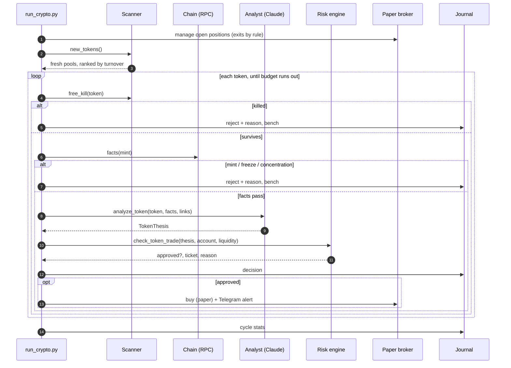

# Architecture

## One cycle (every 60 seconds)

## Budgets

| Resource | Per cycle | Why |
| --- | --- | --- |
| GeckoTerminal | `SCAN.pages` calls | free tier is about 10 calls a minute |
| Solana RPC | 8 tokens × 4 calls | public RPC rate-limits fast |
| Claude | 3 calls | caps the bill no matter what the market does |

## Real-wallet concentration

1. `getAccountInfo(mint)` → mint authority, freeze authority, supply, decimals
2. `getTokenLargestAccounts(mint)` → top token accounts
3. `getMultipleAccounts(token accounts)` → the owner of each
4. `getMultipleAccounts(owners)` → which program owns each owner

Owners held by the System Program are wallets. Anything else (bonding curve, pool, vault) is excluded from concentration and reported as `program_held_pct`.

## The bench

A rejected token sits out for a time set by **why** it failed: 10 minutes for "too young", 4 hours for "no sells", forever for an open mint authority, 6 hours after any exit. See `BENCH_MINUTES` in `config.py`.
